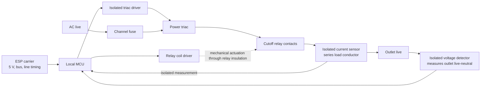

# MCU-controlled AC output module

Status: discussion proposal, 2026-11-13. This records the voltage/current-feedback,
local-MCU direction explored in conversation. Current sensing is restored to
the full-feature proposal for assessment before any later simplification.
Component choices, bus details
and circuit qualification remain open; the existing native CAD has not been
updated to implement this proposal.

One board controls one AC outlet. The current overall arrangement uses two
identical output boards, an ESP32-C6 controller/AC-input board and a sensor
multiplexer board. The application under discussion is 120 VAC, 60 Hz, with
up to 300 W per output for qualified heaters or lamps.

The controller's minimum supported capacity is **16 independently addressable
single-output boards on one output-control bus**, recorded in draft
`MOT-AC-009`. This is a capacity target; the initial device still uses two
output boards, and sixteen is not a maximum. Wiring, bus traffic, power and
line-reference distribution need qualification at the full supported count.
The count does not uprate the chosen mains input or low-voltage supply.

## Functional arrangement



This is a functional diagram, not a wiring schematic. Neutral connects to the
outlet and voltage detector. Protective earth passes uninterrupted to the
outlet. The relay is illustrated after the triac, consistent with the proposed
load-side cutoff arrangement; final placement and connections need review.

The MCU, communication bus, relay coil driver and programming connections
remain on the isolated low-voltage side. The optotriac, voltage detector,
current sensor and relay coil/contact insulation provide the crossings to
mains circuitry. The sensor's load conductor is on the mains side and its
readout is on the low-voltage side. No
separate mains-referenced DC supply is needed for this arrangement.

## Preliminary component groups

| Block | Proposed contents and selection state |
| --- | --- |
| Local controller | STM32C011-class MCU, decoupling, watchdog and defined reset/startup states; exact SKU and pin allocation pending. |
| Low-voltage supply | Incoming 5 V for the relay coil and a small local 3.3 V regulator for the MCU. |
| Communication | Bus connector, module address selection and appropriate interface protection; I2C, SPI and UART have been discussed without a final choice. |
| Programming | Reset/boot connections supporting ESP-assisted programming, plus debug pads; final access and recovery procedure pending. |
| Triac drive | Random-phase optotriac and gate network, allowing both phase-angle firing and whole-cycle control. |
| Power switching | Existing ST BTA08-600SWRG candidate, heatsink, channel fuse and manually configurable RC snubber. |
| Second cutoff | Existing Omron G6DN-1A-L DC5 candidate, transistor coil driver and coil suppression. |
| Voltage feedback | Optically isolated output-voltage detector with deliberate thresholds/loading to reject permitted leakage. Exact device and values pending. |
| Current feedback | Isolated current sensor and local acquisition; Hall sensor plus MCU ADC is a working direction, with TMCS1123 and current-only ACS37800 as research candidates. Exact device, range, filtering and timing remain open. |

The earlier MOC3063 zero-cross optotriac cannot provide arbitrary phase-angle
firing. The random-phase replacement is still to be selected. See
[ST AN5114](https://www.st.com/resource/en/application_note/an5114-controlling-a-triac-with-a-phototriac-stmicroelectronics.pdf).

An AC-input phototransistor optocoupler such as
[Vishay H11AA1](https://www.vishay.com/docs/83608/h11aa1.pdf), or a threshold
detector such as
[Broadcom ACPL-K370/K376](https://docs.broadcom.com/doc/AV02-2153EN), illustrates
the feedback approach. These are candidate mechanisms, not qualified selections.

## Signals

| Signal | Role |
| --- | --- |
| 5 V and low-voltage GND | Power the output module from the controller supply. |
| Command/status bus | Carry output configuration, requested level, command validity, communication-failure policy/fallback settings, status and faults. |
| Shared isolated line-timing reference | Synchronize local firing to the AC line; source circuit and distribution pending. |
| Local triac gate drive | Trigger the optotriac at the selected time. |
| Local output-voltage feedback | Observe outlet voltage independently of the gate command. |
| Local current feedback | Observe load-current magnitude/polarity and conduction timing relative to the shared line reference. |
| Local cutoff relay drive | Interrupt the output supply after a detected unintended-energization fault or when the selected communication-failure response is off. |
| Reset/boot/debug access | Program, update and recover the local MCU. |

The gate, feedback and relay-control signals stay local to each module. The
ESP does not need to generate every triac firing pulse over the communication
bus. A separate inhibit/fault wire and the interconnect pin count remain open
design choices.

## Division of control

The ESP can retain temperature regulation and send each output module its
mode, requested output level and command-validity information. The local MCU
handles leading-edge phase-angle timing or zero-cross-aligned whole-cycle
burst control, voltage/current acquisition and feedback comparison, command
expiry and cutoff operation.

The module reports observed state and faults. Passive bias establishes off
defaults while the MCU is unpowered, resetting or high impedance. Runtime
loss of communication to an operating module uses the configurable response
below. The cutoff path remains operable during a stalled command bus.
These mechanisms do not establish protection against every shared controller
or sensor failure.

## Configurable communication-failure response

Each output has a configurable command-expiry interval and response policy.
When valid commands stop arriving, the powered output module applies the
selected response locally, without needing a working bus.

| Response | Behavior after command expiry |
| --- | --- |
| Off | Set zero output, inhibit firing and request cutoff. |
| On | Set full output, subject to electrical-fault and timing inhibits. |
| Hold latest | Continue the last valid commanded modulation mode and output level. |
| Hold set | Apply a separately configured fallback modulation mode and output level. |

Both hold responses continue normal phase-angle or whole-cycle modulation.
For example, losing communication during the off portion of a 40% heater
burst does not freeze the output off; hold latest continues the 40% schedule.
Hold set is independent of the last normal command and can instead select a
configured fallback such as 20% whole-cycle output.

An absent or invalid policy uses off. Startup/reset stays off until a valid
actuation command is received; the runtime fallback policy does not override
passive hardware defaults. Electrical faults and invalid line timing take
precedence over on or hold policies, and fallback does not clear a latched
fault or bypass rearm. Invalid messages do not refresh command validity.

Recovery requires a fresh valid actuation command, rather than bus activity
alone. Diagnostics identify communication failure, the selected policy,
effective fallback mode/level and any overriding inhibit. Conduction feedback
is checked against that effective local target: changing from a normal 0%
command to fallback on is intentional, while delivery inconsistent with the
effective target still triggers the applicable fault handling. Exact timeout
limits, persistence across resets and protocol encoding remain open.

## Persistent storage

Any settings selected for retention across MCU restarts or power cycles use
double-buffered persistent storage under draft `MOT-STOR-001`. This applies
to the output MCU and the main ESP, including SDK-managed mutable state.
The choice of which settings persist remains separate from this storage rule.

Updates prepare the inactive copy while preserving the committed copy, read
back and verify the durable payload and metadata, then commit and verify a
protected active-selector update. Copies occupy separately erasable regions;
the selector also tolerates interrupted writes. Related settings form one
transaction so a restart cannot combine incompatible generations.

Interrupted or failed updates retain a recoverable complete committed state.
No usable copy produces an explicit storage failure and the applicable safe
defaults. Firmware only acknowledges persistence after durable activation.
Actual flash layouts, capacity/endurance and reset/migration behavior need
qualification. Existing SDK-managed Matter/Thread storage has not yet been
assessed against this rule.

## Voltage/current feedback and diagnostic limits

The full-feature proposal includes both voltage-presence feedback and isolated
current sensing. Voltage feedback observes whether power is available at the
outlet, including the unloaded shorted-triac case. Current observations add
load-conduction information and can be correlated with the line reference to
examine delayed current zero crossings and other inductive-load behavior.
Draft `MOT-AC-010` captures the current-observation capability; it remains
unimplemented and does not qualify arbitrary inductive loads for use.

The MCU can derive RMS current from appropriately acquired observations;
accuracy, update rate and exported telemetry remain open. Real watts/energy
would need additional voltage information or explicitly labeled estimation.
The acquisition bandwidth, offset/noise, minimum detectable current, inrush
headroom and timing delays need assessment for full and dimmed loads. A slow
averaged current reading alone does not establish current-phase behavior.

The detector retains individual AC pulses for comparison against expected
switching times. A heavily smoothed presence indication alone would not
establish correct phase-angle timing. Detector thresholds, delays, minimum
usable off interval and noise margin need qualification.

A shorted triac is detected during a qualifying gate-off interval, both with
and without an external load. The proposed 10 nF snubber passes approximately
0.45 mA at 120 V, 60 Hz; permitted leakage and switching transients need to be
distinguished from unintended energization.

With sensing after the cutoff relay, opening the relay permits observation of
outlet-voltage removal but masks subsequent triac testing. Missing mains, an
open cutoff or an insufficient off interval makes the current diagnostic
observation unavailable; an earlier fault retains its output attribution.

Detection at continuous 100% or near-100% drive without a qualifying natural
off interval is deferred. Inserting test interruptions remains an optional
future software policy, subject to the detector's response limits. A healthy
unloaded triac may not latch through the small detector load, so absent
unloaded on-state voltage is not automatically diagnosed as a failed triac.

## Physical grouping

```text
+--------------------------------------------------+
| Bus / power     MCU, address, programming         |
| connectors      relay driver, probe/touch points  |
|                                                  |
| ----------- mains isolation spacing ------------ |
|       optotriac   voltage detector/current sensor |
|       relay coil/contact insulation boundary     |
|                                                  |
| AC input   fuse   triac + heatsink   AC output    |
|                         cutoff relay contacts    |
+--------------------------------------------------+
```

This is a grouping sketch, not a placement or clearance drawing. The relay
spans the boundary through its coil/contact insulation. Component ratings,
PCB spacing, heatsink clearance and wiring need joint review. Low-voltage
touch/probe points remain on top and clear of mains circuitry.

The strong target is at most 100 mm in either board outline dimension. The
power components, heatsink and isolation spacing are expected to dominate
size; the outline and enclosure arrangement remain open.

## Requirements and remaining decisions

Draft `MOT-AC-001` through `MOT-AC-010` in
[requirements.rqml](../requirements.rqml) cover modulation, short detection,
feedback, cutoff, local regulation, configurable communication-failure
responses, isolation, minimum sixteen-board capacity and current observation.
Existing
`MOT-HW-001/002` address pin assessment and hardware defaults; `MOT-HW-005/006`
address touch/probe access and `MOT-HW-007/008` address the board-size target.
Voltage availability and observed load current remain distinct feedback
quantities; their processing thresholds and interpretation need definition.

Next decisions include bus and connector choice, MCU pin allocation and
programming access, the shared line-reference circuit, optotriac selection,
voltage-detector thresholds and timing, current-sensor range/acquisition,
cutoff/rearm policy and thermal/EMI
qualification. Per-output cutoff is the arrangement illustrated here; a shared
cutoff remains an alternative.

See also the broader [hardware candidate record](hardware-candidates.md) and
the [current native CAD study](../hardware/controller/README.md).
