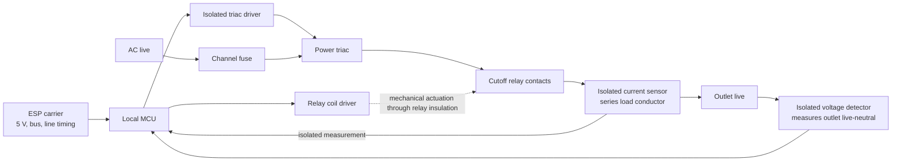

# MCU-controlled AC output module

Status: exploratory CAD study, updated 2026-11-16. This records the voltage/current-feedback,
local-MCU direction explored in conversation. Current sensing is restored to
the full-feature proposal for assessment before any later simplification.
Component choices, bus details
and circuit qualification remain open. The native schematic and exploratory PCB
placement/routing now represent this architecture; firmware and hardware qualification
remain pending. See the [pin/default review](../hardware/controller/intelligent-output-review.md)
for exact pin assignments, power domains and unresolved limits.
The [AC passive review](../hardware/controller/ac-passive-review.md) records the
new pulse-rated parts, regional assembly choices and remaining qualification limits.

One board controls one AC outlet. The current overall arrangement uses two
identical output boards, an ESP32-C6 controller/AC-input board and a sensor
multiplexer board. The application under discussion is 120 VAC, 60 Hz, with
up to 300 W per output for qualified heaters or lamps.

The preferred capacity is **16 independently addressable single-output boards
on one output-control bus**, recorded in draft `MOT-AC-009`. Fewer may be agreed
if sixteen adds significant cost or difficulty; more is desirable if inexpensive
and straightforward. The initial device still uses two output boards. Wiring,
bus traffic, power and line-reference distribution need qualification at the
declared supported count. That count does not uprate the chosen mains input or
low-voltage supply.

[ADR-0020](../.rqml/adr/0020-intelligent-output-module-proposal.md)
records the recommended ESP/local-MCU split, short internal I2C plus separate
line reference, and commissioning alternatives. Draft `MOT-AC-011` makes
ESP-assisted programming, including blank-device commissioning and recovery, the
expected capability unless an expensive or difficult implementation warrants an
agreed alternative. Initial commissioning permits one new board at the selected
default address at a time; other boards at nonconflicting addresses can remain
on the same bus. The C011
candidate has a factory 96-bit UID, but all its ROM I2C loaders use address 0x64;
application address switches do not solve initial target selection. Identity is
separate from runtime addressing (`MOT-AC-012`). The ESP uses the complete,
globally unique hardware identity for configuration, fault records and firmware
updates; an address is only the board's current endpoint. See the ADR's ST
references and the address plan below.

International mains support is preferred (`MOT-AC-013`), with nominal 100-240 V
and 50/60 Hz as the scope to assess, not a qualified rating. `MOT-AC-014` records
the initial 300 W / 120 V resistive-load target. Higher-current feasibility is
deferred to [issue #30](https://github.com/altendky/motley/issues/30) while the
initial design proceeds; no larger rating is selected. General inductive-load
discussion/qualification remains deferred.

## Identity, commissioning and address plan

Draft `MOT-AC-012` is now a must-level requirement: use a documented manufacturer
and UID-scheme namespace plus the complete immutable silicon UID (or an
equivalent globally unique mechanism). Do not shorten it to a display hash or
substitute a shared MCU product ID. Configuration, retained fault records and
update state follow that identity when addresses change or the ESP restarts.
A replacement board at an old address is a different device; reusing the old
logical role requires explicit rebinding rather than inheriting its settings or
clearing its predecessor's faults. This identifies hardware, not cryptographic
authenticity. Persistent bindings follow `MOT-STOR-001`.

The commissioning procedure admits exactly **one new board responding at the
selected default address**. Already commissioned boards, and other boards using
nonconflicting addresses, may remain connected on the **same bus**; they do not
need separate electrical paths. Read the new board's full hardware identity,
assign an available runtime endpoint, program/verify the image, verify the
runtime identity/address and durably record the binding. This permits adding new
boards one at a time to an existing populated bus without an automatic selector.
Only one responder may use the active commissioning default (currently `0x64`
for the C011 ROM loader); a previously commissioned board unexpectedly entering
that loader could still collide. An I2C ACK cannot count identical-address
responders, so the documented connection/boot procedure must establish the
single-default-responder precondition.
Updates and recovery also verify the actual target's identity before writes,
including through the loader/debug path when application firmware is unavailable.

All addresses below are **7-bit I2C addresses without the R/W bit**. The table is
the current reservation inventory for draft `MOT-AC-015`, not a selected runtime
allocation pool. Device defaults are device-specific, not universal I2C rules.

| Address/range | Meaning | Allocation policy and scope |
| --- | --- | --- |
| `0x00-0x07` | I2C special/reserved addresses, including general call | Exclude from ordinary output addresses and ordinary output discovery. |
| `0x78-0x7F` | I2C special/reserved range, including 10-bit address prefixes | Exclude from ordinary 7-bit output addresses. |
| **`0x64`** | **STM32C011 factory ROM loader** | Reserve from normal output allocation and discovery; access only in explicit service mode. ST's address bytes are `0xC8` write / `0xC9` read; those are not additional 7-bit addresses. Recheck this entry if the MCU changes. |
| `0x70-0x77` | Existing TCA9548A selectable mux addresses, all address pins low = `0x70` | Keep out of an output allocation pool wherever a sensor/other mux is reachable on that bus. Separate physical buses have independent address spaces. |
| `0x44` | Current SHT45-family sensor address; some other SHT4x orderables use `0x45` or `0x46` | Account for the exact probe/BOM wherever a downstream sensor channel can be visible on a shared bus. These are device-specific conflicts, not universal reservations. |
| Not selected | Any application-level uncommissioned/discovery address or range | Define explicitly and reserve from normal allocation before supporting that protocol. The ROM address is not automatically an application default. |
| Not selected | Normal output runtime allocation pool | Select after the bus/topology and complete device/default inventory; exclude applicable reservations and occupied endpoints, and assess inexpensive capacity beyond sixteen. |

Runtime discovery and commands use the declared normal pool, keeping service
endpoints separate; they do not blindly scan or send normal output packets to
every address. Binding reconciliation rechecks identity before using per-board
configuration or updates, and reports duplicates, missing identities and address
collisions without conflating records. This does not yet select an automatic
address-discovery/arbitration algorithm. Adding a peripheral, alternate MCU or
protocol requires revisiting the inventory; there is no universal list of every
device's default address.

Sources: [NXP UM10204, reserved addresses](https://www.nxp.com/docs/en/user-guide/UM10204.pdf),
[ST AN2606, C011 loader table](https://www.st.com/resource/en/application_note/an2606-.pdf),
[TI TCA9548A addressing](https://www.ti.com/lit/ds/symlink/tca9548a.pdf),
[Sensirion SHT4x orderable addresses](https://sensirion.com/media/documents/33FD6951/6A7C10A0/HT_DS_Datasheet_SHT4x_V7.3.pdf).

## Recovery controls and watchdogs

Provide each output board with a marked **RUN/RECOVERY jumper or DIP switch**
and reset access. For the C011 candidate, RECOVERY requests system-memory boot
through BOOT0; apply reset or power-cycle, let the ESP identify/program/verify
the board, then return to RUN and reset. Only one board may respond at the
active loader/default address, while other boards at nonconflicting addresses
remain connected. Exact switch/header parts, bias/series values and reset
implementation remain schematic choices under `MOT-HW-001/002` and
`AC-MOT-AC-011-07`.

ST's factory loader is in read-only system memory, separate from writable
application flash; ordinary reflashing or mass erase cannot overwrite it.
Recovery **entry** still depends on configuration. On C011, commissioning must
establish and verify pin-driven boot selection (`NBOOT_SEL=0`, `NBOOT1=1`,
`BOOT_LOCK=0`) and usable external reset. Factory `NBOOT_SEL=1` ignores the
external BOOT0 selection. `BOOT_LOCK` and incompatible protection can prevent
entry; RDP level 2 permanently prevents system-memory boot/debug and is excluded
from the supported recovery configuration. The jumper is not a bypass for those
locks. BOOT0 shares **PA14/SWCLK**, so bias, switch state and pin use must remain
compatible with SWD and normal operation. Option-byte changes still need the
existing persistence/power-loss assessment; immutable ROM does not prove those
updates safe.

Draft `MOT-ENG-010` requires **every MCU**, including the main ESP and each output
MCU, to have a documented watchdog health signal and expiry response. An internal
hardware watchdog is a valid baseline when its clock/refresh/response meets the
failure model; a new external WDI wire is not assumed. Refresh requires actual
critical-work progress rather than an unconditional periodic interrupt. Local
output-MCU expiry returns its actuators to off; main-ESP expiry leaves autonomous
outputs subject to their configured communication-failure policy and higher
priority inhibits. Startup, maintenance and recovery behavior need explicit
bounds. The C011 ROM loader refreshes an already hardware-enabled independent
watchdog, which must be accounted for in the recovery policy.

Sources: [ST boot-process FAQ](https://community.st.com/stm32-mcus-60/faq-stm32-boot-process-37),
[RM0490 boot and option-byte definitions](https://www.st.com/resource/en/reference_manual/dm00781702.pdf),
[STM32C0 protection lifecycle](https://wiki.st.com/stm32mcu/wiki/Security:RDP_for_STM32C0),
[C011 watchdog/pin definitions](https://www.st.com/resource/en/datasheet/stm32c011d6.pdf),
[AN2606 C011 loader/watchdog behavior](https://www.st.com/resource/en/application_note/an2606-.pdf).
These document candidate capabilities; recovery and watchdog hardware tests
remain pending. The CAD includes the recovery shunt, reset button and SWD
header; watchdog configuration and healthy-progress supervision require firmware.

## Functional arrangement



This is a functional diagram, not a wiring schematic. Neutral connects to the
outlet and voltage detector. Protective earth passes uninterrupted to the
outlet. The relay is illustrated after the triac, consistent with the proposed
load-side cutoff arrangement; final placement and connections need review.

The MCU, communication bus, relay coil driver and programming connections
remain on the isolated low-voltage side. The optotriac, voltage detector,
current sensor and relay coil/contact insulation provide the crossings to
mains circuitry. The sensor's load conductor is on the mains side and its
readout is on the low-voltage side. No
separate mains-referenced DC supply is needed for this arrangement.

## Preliminary component groups

| Block | Proposed contents and selection state |
| --- | --- |
| Local controller | STM32C011F6P6, TSSOP20, with local command pull-downs and decoupling; internal watchdog and firmware/storage fit remain to be implemented and verified. |
| Low-voltage supply | Selected 5 V powers local AP2112 3.3 V logic/sensing; separate raw mains-derived 5 V powers the relay coil and optotriac LED. USB alone cannot supply actuator power. |
| Communication | Six-contact internal header, protected I2C on PB7 SDA/PB6 SCL, and shared buffered line reference. Runtime addresses and protocol remain open. |
| Programming | SW20 RUN/RECOVERY shunt, SW21 reset and J21 SWD access; ESP-assisted ROM programming, boot-option and persistence qualification pending. |
| Triac drive | Vishay VO3053-X007T random-phase optotriac, 270 ohm LED resistor, four series gate-resistor positions and pulse-rated 330 ohm gate/A1 shunt; 1 nF transistor-base filter. LOW fits two 1.2k PR02 resistors and two 0-ohm bypasses; HIGH fits four 1.2k resistors and omits the bypasses. |
| Power switching | Existing ST BTA08-600SWRG candidate, heatsink, channel fuse and manually configurable RC snubber. |
| Second cutoff | Existing Omron G6DN-1A-L DC5 candidate, transistor coil driver and coil suppression. |
| Voltage feedback | ACPL-K370 after the relay; LOW 90–132 V uses 8.2k + 8.2k + (8.2k parallel 8.2k), a fitted 0-ohm series link and 2.7k input shunt. HIGH 180–264 V uses four series 8.2k, omits the parallel branch and fits a 1.5k shunt. These BOM variants do not qualify the whole board for either range. |
| Current feedback | TMCS1123B5AQDVGR, 150 mV/A, series between relay and outlet. VOUT and VREF_OUT feed separate MCU ADC channels through 100 ohm/1 nF filters. Range, drift, sampling and thermal qualification remain open. |

The earlier MOC3063 zero-cross optotriac cannot provide arbitrary phase-angle
firing. VO3053-X007T is the current study replacement. See
[ST AN5114](https://www.st.com/resource/en/application_note/an5114-controlling-a-triac-with-a-phototriac-stmicroelectronics.pdf).

An AC-input phototransistor optocoupler such as
[Vishay H11AA1](https://www.vishay.com/docs/83608/h11aa1.pdf), or a threshold
detector such as
[Broadcom ACPL-K370/K376](https://docs.broadcom.com/doc/AV02-2153EN), illustrates
the feedback approach. These are candidate mechanisms, not qualified selections.

## Signals

| Signal | Role |
| --- | --- |
| Selected 5 V, raw 5 V and low-voltage GND | Separate commissioning/logic power from mains-derived actuator power. |
| Command/status bus | Carry output configuration, requested level, command validity, communication-failure policy/fallback settings, status and faults. |
| Shared isolated line-timing reference | Carrier ACPL-K376 plus SN74LVC1G17 buffer; ESP GPIO1 observes it and each output receives it on PA6. Threshold-gap timing and fanout remain unqualified. |
| Local triac gate drive | Trigger the optotriac at the selected time. |
| Local output-voltage feedback | Observe outlet voltage independently of the gate command. |
| Local current feedback | Observe load-current magnitude/polarity and conduction timing relative to the shared line reference. |
| Local cutoff relay drive | Interrupt the output supply after a detected unintended-energization fault or when the selected communication-failure response is off. |
| Reset/boot/debug access | Program, update and recover the local MCU. |

The gate, feedback and relay-control signals stay local to each module. The
ESP does not need to generate every triac firing pulse over the communication
bus. The study connector order is **GND, selected 5 V, SDA, SCL, SYNC,
raw 5 V**. LP Qwiic power/pulls now use main 3.3 V; the HP/sensor bus remains
on the switched sensor supply. A separate inhibit/fault wire remains optional.

## Division of control

The ESP can retain temperature regulation and send each output module its
mode, requested output level and command-validity information. The local MCU
handles leading-edge phase-angle timing or zero-cross-aligned whole-cycle
burst control, voltage/current acquisition and feedback comparison, command
expiry and cutoff operation.

The module reports observed state and faults. Passive bias establishes off
defaults while the MCU is unpowered, resetting or high impedance. Runtime
loss of communication to an operating module uses the configurable response
below. The cutoff path remains operable during a stalled command bus.
These mechanisms do not establish protection against every shared controller
or sensor failure.

## Configurable communication-failure response

Each output has a configurable command-expiry interval and response policy.
When valid commands stop arriving, the powered output module applies the
selected response locally, without needing a working bus.

| Response | Behavior after command expiry |
| --- | --- |
| Off | Set zero output, inhibit firing and request cutoff. |
| On | Set full output, subject to electrical-fault and timing inhibits. |
| Hold latest | Continue the last valid commanded modulation mode and output level. |
| Hold set | Apply a separately configured fallback modulation mode and output level. |

Both hold responses continue normal phase-angle or whole-cycle modulation.
For example, losing communication during the off portion of a 40% heater
burst does not freeze the output off; hold latest continues the 40% schedule.
Hold set is independent of the last normal command and can instead select a
configured fallback such as 20% whole-cycle output.

An absent or invalid policy uses off. Startup/reset stays off until a valid
actuation command is received; the runtime fallback policy does not override
passive hardware defaults. Electrical faults and invalid line timing take
precedence over on or hold policies, and fallback does not clear a latched
fault or bypass rearm. Invalid messages do not refresh command validity.

Recovery requires a fresh valid actuation command, rather than bus activity
alone. Diagnostics identify communication failure, the selected policy,
effective fallback mode/level and any overriding inhibit. Conduction feedback
is checked against that effective local target: changing from a normal 0%
command to fallback on is intentional, while delivery inconsistent with the
effective target still triggers the applicable fault handling. Exact timeout
limits, persistence across resets and protocol encoding remain open.

## Persistent storage

Any settings selected for retention across MCU restarts or power cycles use
double-buffered persistent storage under draft `MOT-STOR-001`. This applies
to the output MCU and the main ESP, including SDK-managed mutable state.
The choice of which settings persist remains separate from this storage rule.

Updates prepare the inactive copy while preserving the committed copy, read
back and verify the durable payload and metadata, then commit and verify a
protected active-selector update. Copies occupy separately erasable regions;
the selector also tolerates interrupted writes. Related settings form one
transaction so a restart cannot combine incompatible generations.

Interrupted or failed updates retain a recoverable complete committed state.
No usable copy produces an explicit storage failure and the applicable safe
defaults. Firmware only acknowledges persistence after durable activation.
Actual flash layouts, capacity/endurance and reset/migration behavior need
qualification. Existing SDK-managed Matter/Thread storage has not yet been
assessed against this rule.

## Voltage/current feedback and diagnostic limits

The full-feature proposal includes both voltage-presence feedback and isolated
current sensing. Voltage feedback observes whether power is available at the
outlet, including the unloaded shorted-triac case. Current observations add
load-conduction information and can be correlated with the line reference to
examine delayed current zero crossings and other inductive-load behavior.
Draft `MOT-AC-010` captures the current-observation capability; it remains
unimplemented and does not qualify arbitrary inductive loads for use.

The MCU can derive RMS current from appropriately acquired observations;
accuracy, update rate and exported telemetry remain open. Real watts/energy
would need additional voltage information or explicitly labeled estimation.
The acquisition bandwidth, offset/noise, minimum detectable current, inrush
headroom and timing delays need assessment for full and dimmed loads. A slow
averaged current reading alone does not establish current-phase behavior.

The detector retains individual AC pulses for comparison against expected
switching times. A heavily smoothed presence indication alone would not
establish correct phase-angle timing. Detector thresholds, delays, minimum
usable off interval and noise margin need qualification.

A shorted triac is detected during a qualifying gate-off interval, both with
and without an external load. The fitted 9.4 nF pulse-rated snubber passes approximately
0.43 mA at 120 V, 60 Hz; permitted leakage and switching transients need to be
distinguished from unintended energization.

With sensing after the cutoff relay, opening the relay permits observation of
outlet-voltage removal but masks subsequent triac testing. Missing mains, an
open cutoff or an insufficient off interval makes the current diagnostic
observation unavailable; an earlier fault retains its output attribution.

Detection at continuous 100% or near-100% drive without a qualifying natural
off interval is deferred. Inserting test interruptions remains an optional
future software policy, subject to the detector's response limits. A healthy
unloaded triac may not latch through the small detector load, so absent
unloaded on-state voltage is not automatically diagnosed as a failed triac.

## Physical grouping

```text
+--------------------------------------------------+
| Bus / power     MCU, address, programming         |
| connectors      relay driver, probe/touch points  |
|                                                  |
| ----------- mains isolation spacing ------------ |
|       optotriac   voltage detector/current sensor |
|       relay coil/contact insulation boundary     |
|                                                  |
| AC input   fuse   triac + heatsink   AC output    |
|                         cutoff relay contacts    |
+--------------------------------------------------+
```

This is a grouping sketch, not a placement or clearance drawing. The relay
spans the boundary through its coil/contact insulation. Component ratings,
PCB spacing, heatsink clearance and wiring need joint review. Low-voltage
touch/probe points remain on top and clear of mains circuitry.

The strong target is at most 100 mm in either board outline dimension. The
power components, heatsink and isolation spacing are expected to dominate
size; the outline and enclosure arrangement remain open.

## Requirements and remaining decisions

Draft `MOT-AC-001` through `MOT-AC-015` in
[requirements.rqml](../requirements.rqml) cover modulation, short detection,
feedback, cutoff, local regulation, configurable communication-failure
responses, isolation, preferred sixteen-board capacity, current observation,
ESP-assisted programming, global identity/tracking, preferred international
compatibility, initial load capability and explicit address reservations.
Existing
`MOT-HW-001/002` address pin assessment and hardware defaults; `MOT-HW-005/006`
address touch/probe access and `MOT-HW-007/008` address the board-size target.
Voltage availability and observed load current remain distinct feedback
quantities; their processing thresholds and interpretation need definition.

Next decisions include bus and connector choice, MCU pin allocation and
programming access, the shared line-reference circuit, optotriac selection,
voltage-detector thresholds and timing, current-sensor range/acquisition,
cutoff/rearm policy and thermal/EMI
qualification. Per-output cutoff is the arrangement illustrated here; a shared
cutoff remains an alternative.

See also the broader [hardware candidate record](hardware-candidates.md) and
the [current native CAD study](../hardware/controller/README.md).
